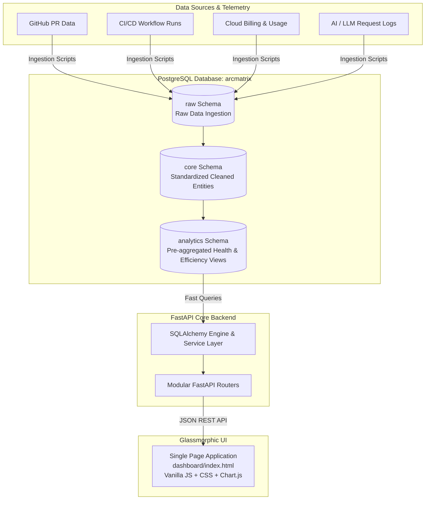

# ArcMatrix ⚡
### Enterprise Technology Intelligence & Action Platform

[](https://www.python.org/)
[](https://fastapi.tiangolo.com/)
[](https://www.postgresql.org/)
[](https://www.sqlalchemy.org/)
[](LICENSE)

**ArcMatrix** is a unified enterprise intelligence and observability platform designed to bridge the operational gap between **Engineering Health**, **CI/CD Delivery**, **Cloud FinOps**, and **AI/LLM Telemetry**. 

By processing raw telemetry into standardized schemas and high-performance analytical aggregates, ArcMatrix empowers engineering leaders, DevOps architects, and FinOps practitioners with real-time operational diagnostics and an automated **Action Center** with prioritized operational recommendations.

---

## 📑 Table of Contents

- [Key Pillars](#-key-pillars)
- [Architecture & Data Flow](#-architecture--data-flow)
- [Technology Stack](#-technology-stack)
- [Repository Structure](#-repository-structure)
- [Getting Started](#-getting-started)
  - [Prerequisites](#prerequisites)
  - [Quick Start (Windows PowerShell)](#quick-start-windows-powershell)
  - [Manual Setup](#manual-setup)
  - [Configuration (.env)](#configuration-env)
- [Database Schema Design](#-database-schema-design)
- [Running the Application](#-running-the-application)
- [API Reference](#-api-reference)
- [Interactive Dashboard](#-interactive-dashboard)
- [ETL & Data Ingestion](#-etl--data-ingestion)
- [Verification & Testing](#-verification--testing)
- [Architectural Design Principles](#-architectural-design-principles)
- [License](#-license)

---

## 🌟 Key Pillars

```
                     ┌─────────────────────────────────────────┐
                     │          ArcMatrix Intelligence         │
                     └────────────────────┬────────────────────┘
                                          │
         ┌──────────────────┬─────────────┴───────┬──────────────────┐
         ▼                  ▼                     ▼                  ▼
┌──────────────────┐ ┌──────────────┐ ┌──────────────────────┐ ┌──────────────┐
│  1. Engineering  │ │  2. CI/CD    │ │     3. Cloud         │ │    4. AI     │
│   Pull Requests  │ │   Delivery   │ │ FinOps & Efficiency  │ │  Telemetry   │
│   & Cycle Time   │ │  Pipelines   │ │   Cost Intelligence  │ │  LLM Quality │
└──────────────────┘ └──────────────┘ └──────────────────────┘ └──────────────┘
         │                  │                     │                  │
         └──────────────────┴─────────────┬───────┴──────────────────┘
                                          ▼
                     ┌─────────────────────────────────────────┐
                     │  5. Action Center & Critical Insights   │
                     └─────────────────────────────────────────┘
```

### 1. 🛠️ Engineering Health & PR Velocity
- **Pull Request Metrics**: In-depth visibility into pull requests, merge rates, and review turnaround times.
- **Cycle Time & Review Latency**: Granular tracking of review delays, approval latency, and developer churn.
- **PR Hygiene Diagnostics**: Automatic detection of oversized pull requests and bottlenecks impeding team velocity.

### 2. 🚀 CI/CD Delivery & Pipeline Reliability
- **Workflow Health**: Pipeline execution success rates, failure spikes, and retry overhead.
- **Duration Analysis**: Identification of slow-running workflows, flaky tests, and build bottlenecks.
- **Repository Scoring**: Pipeline reliability scoring across all repositories.

### 3. ☁️ Cloud FinOps & Cost Intelligence
- **Multi-Cloud Spend Tracking**: Billed cost vs. effective amortized cost across cloud providers (AWS, Azure, GCP).
- **Variance Analysis**: Identification of abnormal spend variances and unexpected resource spikes.
- **Resource Efficiency**: Service-level and region-level cost distribution to eliminate cloud waste.

### 4. 🧠 AI & LLM Telemetry
- **Model Observability**: Real-time request volumes, latency profiles, and error rate telemetry across LLM providers.
- **Token Efficiency**: Token throughput tracking (tokens/sec) and Time-To-First-Token (TTFT) metrics.
- **Model Comparison**: Cross-model performance and operational reliability benchmarking.

### 5. 🎯 Action Center & Prescriptive Recommendations
- **Operational Risk Triaging**: Severity-ranked issues (`CRITICAL`, `WARNING`, `INFO`).
- **Impact-Driven Guidance**: Actionable remediation guidance with estimated engineering and cost impact.

---

## 🏛️ Architecture & Data Flow



---

## 💻 Technology Stack

| Layer | Technology | Details |
|---|---|---|
| **Backend Framework** | [FastAPI](https://fastapi.tiangolo.com/) | Asynchronous, OpenAPI auto-documented REST API |
| **Server Engine** | [Uvicorn](https://www.uvicorn.org/) | High-performance ASGI web server |
| **ORM / Data Layer** | [SQLAlchemy 2.0](https://www.sqlalchemy.org/) | Connection pooling with `pool_pre_ping` and robust SQL execution |
| **Database** | [PostgreSQL](https://www.postgresql.org/) | Three-tier data modeling (`raw`, `core`, `analytics`) |
| **Data Processing** | [Pandas](https://pandas.pydata.org/), [OpenPyXL](https://openpyxl.readthedocs.io/) | High-speed data parsing, ETL transformations, and ingestion |
| **Settings Management** | [Pydantic Settings](https://docs.pydantic.dev/) | Strongly typed environment variable management via `.env` |
| **Frontend** | Vanilla HTML5 / CSS3 / ES6+ | Glassmorphic dark UI, zero external build step dependencies |
| **Visualizations** | [Chart.js 4.4](https://www.chartjs.org/) | Interactive client-side charting for trends, distribution, and telemetry |
| **Typography** | Inter & JetBrains Mono | Modern enterprise design system typography |

---

## 📂 Repository Structure

```
ArcMatrix/
├── backend/
│   ├── api/                     # Modular API Route Controllers
│   │   ├── ai.py                # AI model telemetry endpoints
│   │   ├── cicd.py              # CI/CD delivery & pipeline endpoints
│   │   ├── cloud.py             # Cloud FinOps & cost endpoints
│   │   ├── engineering.py       # GitHub & engineering health endpoints
│   │   ├── insights.py          # Action center & cross-domain insights
│   │   └── platform.py          # Cross-platform summary & health status
│   ├── services/                # Business logic & Database Access Layer
│   │   ├── ai_service.py        # Model metrics & latency aggregation
│   │   ├── cicd_service.py      # Build run health & failure scoring
│   │   ├── cloud_service.py     # FinOps efficiency calculations
│   │   ├── db_service.py        # Query helpers (fetch_all, fetch_one)
│   │   ├── engineering_service.py # PR cycle time & bottleneck analysis
│   │   ├── insight_service.py   # Prescriptive recommendation engine
│   │   └── platform_service.py  # Executive health scoring service
│   ├── config.py                # Pydantic BaseSettings & connection URI
│   ├── database.py              # SQLAlchemy engine & session factory
│   └── main.py                  # FastAPI application entrypoint & static mounting
├── dashboard/
│   ├── index.html               # Enterprise Dark-Mode Glassmorphic Dashboard
│   └── .gitkeep
├── ingestion.py                 # Source dataset ETL orchestrator
├── load_github.py               # GitHub pull requests raw data loader
├── load_cicd.py                 # CI/CD workflow runs raw data loader
├── db_check.py                  # Database connection & schema validator
├── smoke_test.py                # Quick API availability test
├── test_endpoints.py            # Comprehensive endpoint integration test
├── setup_venv.ps1               # Automated Windows virtual environment setup
├── start.ps1                    # One-click environment bootstrap & server startup
├── requirements.txt             # Python dependencies
├── .env.example                 # Environment variables template
├── .gitignore                   # Ignore rules (excludes .env, venvs, caches)
└── README.md                    # Project documentation
```

---

## 🚀 Getting Started

### Prerequisites
- **Python 3.12+**
- **PostgreSQL 14+** running locally or accessible via network
- **PowerShell** (on Windows) or Bash (on Linux/macOS)

---

### Quick Start (Windows PowerShell)

ArcMatrix includes automated scripts to configure your environment and launch the server in seconds:

1. **Bootstrap Virtual Environment & Dependencies**:
   ```powershell
   .\setup_venv.ps1
   ```

2. **Configure Environment File**:
   ```powershell
   Copy-Item .env.example .env
   ```
   *Edit `.env` to supply your PostgreSQL password (`DB_PASSWORD`).*

3. **Launch Platform**:
   ```powershell
   .\start.ps1
   ```
   The dashboard will automatically become available at:
   - **Dashboard**: [http://127.0.0.1:8000/](http://127.0.0.1:8000/)
   - **Interactive API Docs**: [http://127.0.0.1:8000/docs](http://127.0.0.1:8000/docs)

---

### Manual Setup

If you prefer setting up manually:

```bash
# 1. Create virtual environment
python -m venv venv312

# 2. Activate virtual environment
# Windows PowerShell:
.\venv312\Scripts\Activate.ps1
# Linux / macOS:
source venv312/bin/activate

# 3. Upgrade pip and install dependencies
python -m pip install --upgrade pip
pip install -r requirements.txt

# 4. Copy and populate .env
cp .env.example .env
```

---

### Configuration (`.env`)

Configure the following variables in your `.env` file:

```ini
# PostgreSQL Database Connection
DB_HOST=localhost
DB_PORT=5432
DB_NAME=arcmatrix
DB_USER=postgres
DB_PASSWORD=your_secure_password_here

# Local Telemetry Datasets (for raw ETL ingestion)
ARCMATRIX_DATA_ROOT=C:\path\to\raw_datasets

# Server Host & Port
APP_HOST=127.0.0.1
APP_PORT=8000
```

---

## 🗄️ Database Schema Design

ArcMatrix implements a structured three-tier schema architecture in PostgreSQL to separate raw ingest from analytical consumption:

| Schema | Role | Primary Tables |
|---|---|---|
| `raw` | Staging layer holding ingested event logs and source files | `raw.github_prs`, `raw.cicd_runs`, `raw.cloud_costs`, `raw.ai_telemetry` |
| `core` | Cleansed, normalized, and typed dimensional entities | Normalized tables across pull requests, builds, cloud services, and AI prompts |
| `analytics` | High-speed aggregated tables queried directly by the API | `engineering_health`<br/>`cicd_health`<br/>`cloud_efficiency`<br/>`ai_health`<br/>`platform_health`<br/>`cross_domain_insights` |

---

## 🌐 Running the Application

To start the FastAPI application server manually:

```powershell
python -m uvicorn backend.main:app --host 127.0.0.1 --port 8000 --reload
```

| URL | Description |
|---|---|
| `http://127.0.0.1:8000/` | Single-Page Executive Dashboard |
| `http://127.0.0.1:8000/docs` | Swagger / OpenAPI Interactive Documentation |
| `http://127.0.0.1:8000/redoc` | ReDoc API Reference |
| `http://127.0.0.1:8000/health` | Service Liveness Probe |

---

## 🔌 API Reference

### Platform & Health
| Method | Endpoint | Description |
|---|---|---|
| `GET` | `/health` | System health check (`status: ok`) |
| `GET` | `/api/platform/summary` | Executive platform summary across all 4 pillars |
| `GET` | `/api/platform/health` | Domain-level health metrics and scorecards |

### Engineering & PR Intelligence
| Method | Endpoint | Description |
|---|---|---|
| `GET` | `/api/engineering/summary` | Aggregate metrics (PR count, merge count, cycle time, churn) |
| `GET` | `/api/engineering/health` | Engineering domain operational status |
| `GET` | `/api/engineering/diagnostics` | Pull request cycle time and review latency diagnostics |
| `GET` | `/api/engineering/repositories` | Paginated repository list with PR velocity stats |
| `GET` | `/api/engineering/repository/{repo_id}` | Detailed repository metrics and PR breakdown |

### CI/CD Delivery
| Method | Endpoint | Description |
|---|---|---|
| `GET` | `/api/cicd/summary` | Total runs, success rate, failure rate, and retry rate |
| `GET` | `/api/cicd/health` | CI/CD pipeline domain status |
| `GET` | `/api/cicd/health-score` | Composite reliability and health score |
| `GET` | `/api/cicd/repositories` | Paginated build health metrics per repository |
| `GET` | `/api/cicd/repository/{repo}` | Detailed run breakdown for a specific repository |

### Cloud FinOps & Efficiency
| Method | Endpoint | Description |
|---|---|---|
| `GET` | `/api/cloud/summary` | Billed vs effective cost, total cost variance, resources |
| `GET` | `/api/cloud/efficiency` | Spend efficiency indices and waste indicators |
| `GET` | `/api/cloud/intelligence` | Cost optimization recommendations |
| `GET` | `/api/cloud/providers` | Provider list and aggregated cloud costs |
| `GET` | `/api/cloud/services` | Service-level cost breakdown (paginated with search) |

### AI & LLM Telemetry
| Method | Endpoint | Description |
|---|---|---|
| `GET` | `/api/ai/summary` | Total requests, error rate, latency, TTFT, token throughput |
| `GET` | `/api/ai/health` | AI service operational health status |
| `GET` | `/api/ai/models` | Model performance comparison and token rates |
| `GET` | `/api/ai/model/{model}` | Granular telemetry and error metrics for a given model |

### Action Center & Cross-Domain Insights
| Method | Endpoint | Description |
|---|---|---|
| `GET` | `/api/insights/` | Filterable insights list (`domain`, `severity`, `search`) |
| `GET` | `/api/insights/summary` | Insight counts grouped by severity and domain |
| `GET` | `/api/insights/critical` | High-priority operational issues requiring immediate attention |
| `GET` | `/api/insights/warnings` | Elevated warnings across all pillars |
| `GET` | `/api/insights/actions` | Prescriptive action items with remediation steps |
| `GET` | `/api/insights/cross-domain` | Cross-domain correlation findings |

---

## 📊 Interactive Dashboard

The dashboard is served directly from the root path (`/`) without requiring Node.js or Webpack build processes:

- **Glassmorphic Dark Theme**: High-contrast, tailored visual aesthetics with HSL accents and glowing status indicators.
- **Dynamic Tab Switching**: Effortlessly navigate between:
  1. **Overview**: Executive high-level scorecards.
  2. **Engineering / PRs**: Cycle time percentiles, review turnaround, and PR sizes.
  3. **CI/CD Delivery**: Build reliability distributions, pipeline durations, and failure analysis.
  4. **Cloud Costs**: Spend efficiency, provider breakdowns, and variance indicators.
  5. **AI Telemetry**: Model latency distributions, TTFT, and token consumption rates.
  6. **Action Center**: Severity badge counters and actionable remediation cards.
- **Zero Build Tooling**: Fast, zero-overhead browser rendering using native ES modules and CDN-delivered Chart.js.

---

## 🔄 ETL & Data Ingestion

The repository includes dedicated loaders to ingest raw telemetry into PostgreSQL:

```powershell
# Verify database connection and schema availability
python db_check.py

# Ingest GitHub Pull Request data
python load_github.py

# Ingest CI/CD Pipeline execution logs
python load_cicd.py

# Run comprehensive ingestion across all domains
python ingestion.py
```

> **Note**: In standard runtime, the FastAPI backend queries pre-computed analytics tables in `analytics.*`. Ingestion scripts are used only when importing new source data or rebuilding the data pipeline.

---

## 🧪 Verification & Testing

ArcMatrix provides built-in testing scripts to validate system components:

```powershell
# 1. Database Connection & Schema Health Check
python db_check.py

# 2. Fast API Smoke Test
python smoke_test.py

# 3. Comprehensive Endpoints Integration Suite
python test_endpoints.py
```

---

## 📐 Architectural Design Principles

### Responsible Cross-Domain Correlation
ArcMatrix aggregates metrics across four disparate operational domains (GitHub, CI/CD, Cloud FinOps, AI Telemetry). Because each data source possesses unique timestamps, sampling intervals, and natural keys:
- **No Fabricated Causality**: The platform does not assume artificial causal relationships across datasets with divergent time horizons.
- **Domain Integrity**: Every metric retains provenance to its source schema, ensuring that engineering decisions are grounded in verifiable data.
- **Prescriptive Guidance**: Cross-domain insights highlight co-occurring anomalies without misrepresenting them as direct cause-and-effect.

---

## 📄 License

This project is licensed under the [MIT License](LICENSE).
